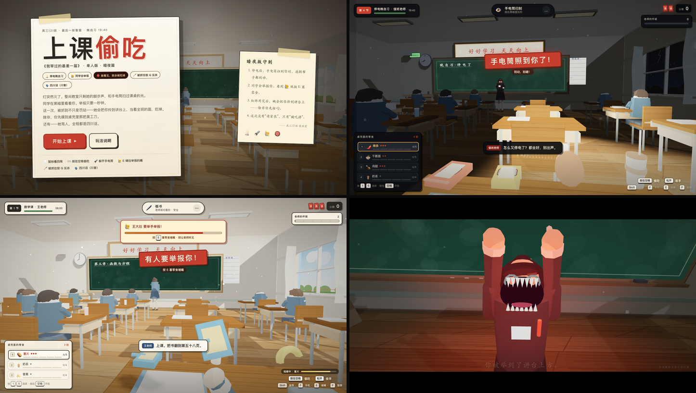
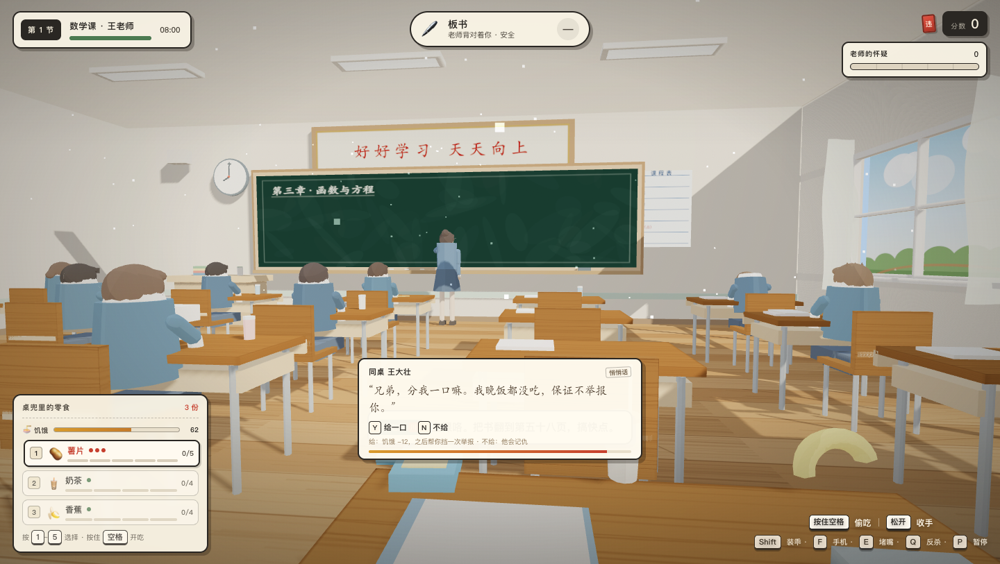
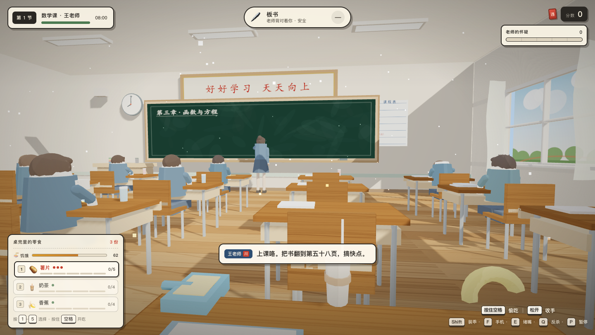
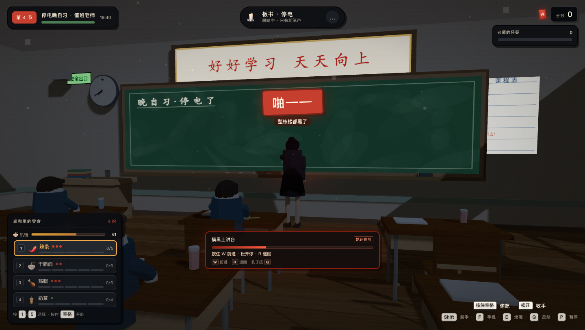
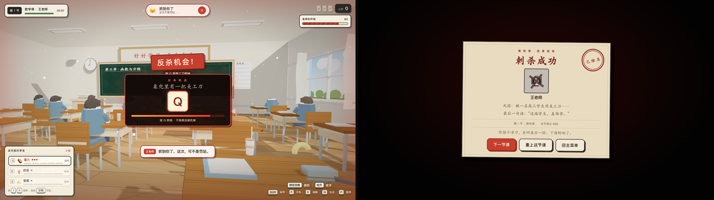
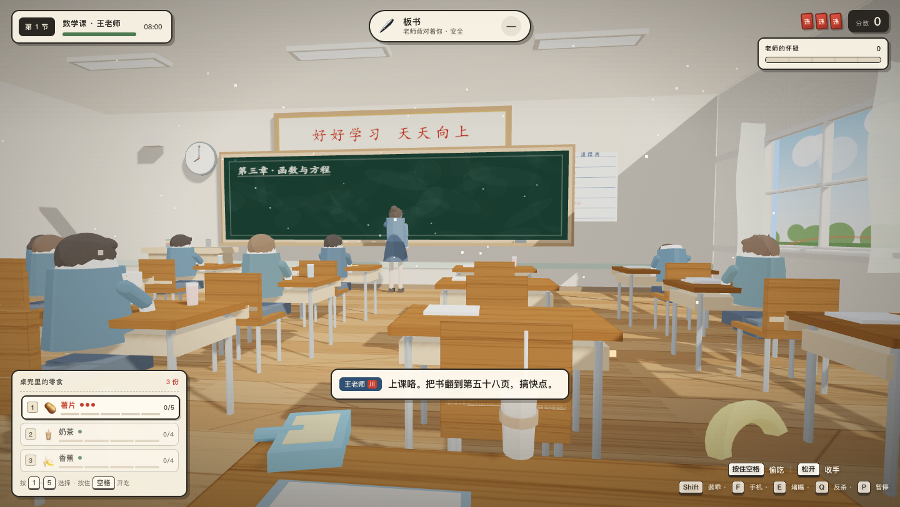

# 上课偷吃 · 暗夜版

A single-player classroom-snack horror game built with vanilla JavaScript + three.js.  
单人课堂偷吃恐怖小游戏：四节课、停电、举报、被老师吃掉，以及——反杀。



> 这是一个可直接运行的单机 demo：打开 `index.html` 就能玩。

## 直接开玩

- **macOS**：双击 `开始游戏.command`
- **Windows**：双击 `开始游戏.bat`
- 或者直接双击 `index.html`

推荐 Chrome / Edge，桌面端。点击「开始上课」后鼠标会被锁定，`Esc` 暂停。  
含 jumpscare、闪烁和恐怖音效，建议戴耳机，声音可以关小。

## 玩法

你坐在最后一排靠窗。桌兜里藏着零食，老师随时会转身。  
每节课只有 **1 张红牌**：第一次被抓是罚站；红牌用完之后再被发现，她会直接把你拎到讲台——吃掉。

- **鼠标 / 方向键**：环顾教室
- **按住空格 / 鼠标左键**：偷吃，松开收手
- **Shift**：装乖，降低怀疑
- **1 ~ 5**：换零食
- **F**：手机贪吃蛇（↑↓←→ 控制）
- **E**：同学举手举报时，塞零食堵嘴
- **Q**：被拎起来时，用桌兜里的美工刀反杀
- **饥饿值**：自动下降；吃零食恢复；低于 30 会肚子叫
- **Y / N**：同桌讨零食时给 / 不给
- **R**：停电时摸黑上讲台 / 中途退回；按住 **W** 前进；摸到讲台后按 **Q** 刺杀
- **P / Esc**：暂停
- **M**：静音

## 四节课

| 节次 | 老师 | 特点 |
|---|---|---|
| 数学课 | 蔡徐坤 | 中分、白上衣、篮球；节奏慢，适合上手 |
| 英语课 | 奶龙 | 黄色大头小龙；转身更快，开始巡视 |
| 班主任的课 | 张主任 | 5 份零食，转身极快 |
| **停电晚自习** | **值班老师** | **手电筒扫射、同学举报、1 张红牌** |

> 第一关蔡徐坤、第二关奶龙是低多边形玩梗建模，不是官方模型/形象。

### 停电晚自习

灯灭了，整栋楼都是黑的。值班老师拿着一支手电筒，光柱会在教室里扫来扫去。  
**光柱照到你时，别嚼、别动手机、屏住呼吸。** 黑暗里的咀嚼声也会被听见。

### 同学会举报你

旁边的同学会注意到你在偷吃，举手打小报告。  
看到顶部 **⚠ 举报倒计时**，立刻按 `E` 塞零食堵嘴；没堵住，老师会立刻转向你，怀疑度大涨。

### 🙋 同学讨零食

老师背过身写板书时，同桌会扯你袖子：

- **Y 给一口**：饥饿值 **-12**，但获得一次“挡举报”——下一次同学要举报你时，他帮你打掩护。
- **N 不给**：他会记仇，下一次举报大概率就是他，倒计时也更短。



### 🍜 饥饿值

每节课从 **62** 开始，随着课堂时间下降；每咬一口零食都会回一点饥饿值。

- 低于 **30**：肚子开始咕噜叫，怀疑度上涨，旁边的同学也会听见。
- 低于 **12**：叫得特别响，老师很可能直接转身。
- 到 **0** 不会立刻死，但会不停叫、不停涨怀疑——离被抓只差一步。



### 🗡️ 停电摸黑刺杀

第 4 节停电晚自习，等值班老师背对你写板书时：

1. 按 **R** 从座位溜下来；
2. 按住 **W** 前进，松开停；粉笔声停、她肩膀一动，立刻按 **R** 退回；
3. 摸到讲台边按 **Q** 刺杀——**成功直接赢下这一局**。

被发现就是普通被抓（红牌/被吃），时机比手速重要。



### 被老师吃掉

红牌用完后再被抓，她会把你从座位上拎起来，带到讲台、举过头顶，然后张开嘴。  
这是一段约 6 秒的第一人称处刑镜头，最后是一张「寻人启事」。

### 反杀

就在她把你拎起来、牙齿凑过来的时候，屏幕会出现 **反杀机会**：桌兜里还有一把美工刀。  
在倒计时结束前按 **Q**，一刀刺过去——进入「刺杀成功」结案报告，这节课直接通过，并额外获得 **500 分**。



### 四川话

老师的所有台词都重写成了四川话；字幕保留正字，老师名字旁有红色「川」标。  
游戏会优先寻找系统里的四川话发音人；如果没有（macOS 自带一般只有普通话/粤语/台湾腔），会在朗读层做川话发音替换 + 压低音高/放慢语速，即「川普版」。



> 想要真正地道的成都口音，需要接讯飞 / 火山 / 豆包等带四川话发音人的在线 TTS。

## 项目结构

```
index.html              游戏入口
css/style.css           全部样式
js/game.js              关卡、老师 AI、偷吃、举报、结局
js/world.js             3D 教室、老师/学生、停电与处刑镜头
js/audio.js             WebAudio 合成音效 + 语音
js/phone.js             手机贪吃蛇
js/vendor/three.min.js  three.js r149（本地，无 CDN）
screenshots/            预览图
开始游戏.command/.bat   双击启动
```

无构建步骤、无网络请求；所有 3D 场景、角色、零食、纹理和音效都由代码生成。

## 技术

- 原生 JavaScript + **three.js r149**（本地 `js/vendor/three.min.js`）
- WebAudio 实时合成音效；`speechSynthesis` 中文语音，字幕兜底
- 第一人称坐姿相机、Pointer Lock、程序化动画、停电 SpotLight、第一人称处刑镜头
- 纯静态，双击 `index.html` 即可运行

## 说明

- 粉丝自制单机版，非官方作品；玩法概念借鉴 B 站视频《我带过的最差一届》（BV1pEJt6YEFf），角色、台词、场景、音效均为原创程序化内容。
- 无外部图片 / 模型 / 音频文件；three.js 按其 MIT 许可证使用。
